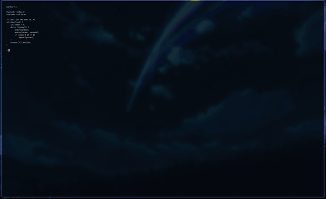

# Hardcore mode for Omarchy

A gimmick for the [Omarchy](https://omarchy.org) shell. Switch it on with the
flame in the bar, and typing sets things off:

- the window you type in **shakes**, with its colours pulled apart;
- **sparks** fly out of the text cursor;
- the **edges of the screen** glow and spray sparks inwards;
- a **combo counter** climbs for as long as you keep typing, and winds
  everything up as it goes;
- **metal guitar**: every key plays the next note of a riff, so your typing
  sets the tempo. Every 25th key in a row gets a squeal on top.

Stop typing and it all stops.



> **Warning:** this flashes and shakes the screen on purpose. Do not use it if
> you are sensitive to flashing or fast-moving images.

## Install

```bash
omarchy plugin add https://github.com/tanevanwifferen/omarchy-hardcore.git --enable --yes
```

The flame appears in the bar. Hardcore mode is off until you click it, and off
again after every restart of the shell.

## Use

| On the flame | Does |
|---|---|
| Click | Hardcore mode on or off |
| Right click | A menu with the mode and a switch for each part |

The menu has four modes:

- **Sparks**: rainbow sparks that fall.
- **Fire**: flames rising off the bottom of the screen.
- **Party**: confetti from the top, a gentler shake.
- **Glitch**: a harder shake that rips strips of the window sideways.

and a switch each for the shake, the sparks, the screen edges, the combo
counter and the guitars. The mode and the switches are remembered in
`~/.local/state/omarchy-hardcore.json`.

For a key binding or a script:

```bash
omarchy-shell hardcore toggle        # on or off
omarchy-shell hardcore mode fire     # sparks, fire, party, glitch, or next
omarchy-shell hardcore sound         # guitars on or off
```

## Requirements

An Omarchy install with the Omarchy shell has almost all of this already.

| Needs | For | Without it |
|---|---|---|
| Omarchy shell on Hyprland | everything | does not run |
| Membership of the `input` group (`groups` shows it) | noticing key presses | nothing happens |
| Python 3 | the helper that watches the keyboard | nothing happens |
| `python-numpy` | the guitars, finding the text cursor | no sound; sparks land anywhere in the window |
| PipeWire with `pw-cat` | the guitars | no sound |
| `grim` 1.5 or newer | finding the text cursor | sparks land anywhere in the window |

```bash
omarchy pkg add python-numpy grim
```

No graphics card is asked for anything special: there is no NVIDIA, CUDA or
AI model involved, and the guitars are worked out on the processor (see
[Sound](#sound)). Nothing is compiled or downloaded, and nothing needs root.

The shake is a Hyprland screen shader, set only while keys are being hit and
taken away when they stop. A screen shader of your own is put back afterwards.
No file of your configuration is changed.

## What it reads, and what it does with it

Hardcore mode has to know *that* you are typing and *where*. Both stay on your
machine: the plugin makes no network connection and writes nothing but its own
settings file.

- **Key presses.** While hardcore mode is on, `bin/keypulse` reads the keyboard
  devices in `/dev/input`. It passes on only the fact that a key went down:
  which key it was is thrown away on the spot, never stored and never sent
  anywhere. The helper does not run while hardcore mode is off.
- **The text cursor.** After a key press it takes a picture of the focused
  window (`grim -T`), compares it with the one from the key before, and takes
  the small patch that changed as the place you are typing at. The pictures
  are compared in memory and dropped; none is written to disk.

Finding the cursor this way works in terminals and ordinary text fields. It
gives up in windows where the picture keeps changing by itself (a video call),
and the sparks then land anywhere in the window.

## Sound

The guitar is not a recording and not AI-generated. `bin/riffgen` works every
note out with a little arithmetic, on the processor, in about a second:

1. A plucked string: a burst of noise goes round a short delay line that
   dulls it a little on every lap (the Karplus-Strong method). The length of
   the line sets the pitch; dulling it harder gives a palm-muted chug.
2. Three strings make a power chord (root, fifth, octave), played twice
   slightly out of tune, like two guitars.
3. That goes hard into a clipping amplifier, which is where the distortion
   comes from, and through a filter shaped like a speaker cabinet.

The results are the eleven short `.wav` files in `sounds/`: three chugs, six
chords, a squeal and a ringing last chord. They are in the repository, so you
only run `bin/riffgen` to change the sound, and then it wants `python-scipy`
as well.

While you type, the notes are mixed into one open stream with a 5 ms buffer,
so they follow the keys closely on wired speakers. Bluetooth headphones add
their own delay.

## Remove

```bash
omarchy plugin remove io.github.tanevanwifferen.hardcore --yes
rm -f ~/.local/state/omarchy-hardcore.json
```

## Changing it

A change to `Service.qml` shows up after `omarchy restart shell`; the other
files reload when saved. The modes are a table at the top of `Service.qml`.

## License

MIT, see [LICENSE](LICENSE).
